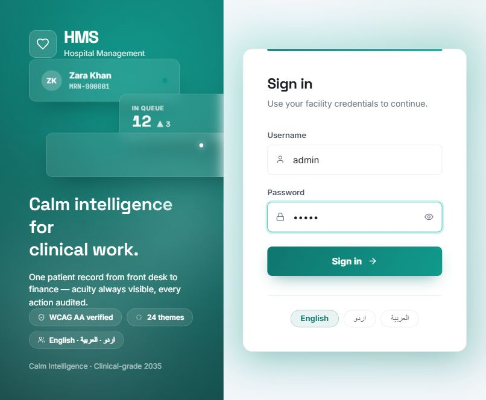
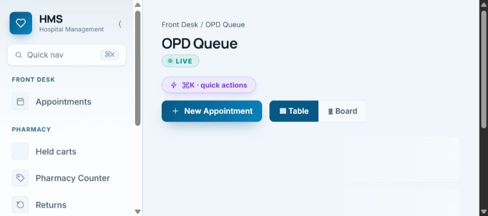

# EHMS product documentation

## Run the frontend

From this repository folder, run `npm run dev`, then open `http://localhost:3000`.
The frontend project and its installed dependencies live in `nextjs-structure/`.
If dependencies are missing, run `npm --prefix nextjs-structure install` first.

**Hospital management system · product and delivery blueprint · 12 October 2026**

This folder is a documentation-first planning package for a modern, multilingual hospital management platform inspired by the live EHMS interface and the supplied client story. It contains **no application code**. The `nextjs-structure` directory is a proposed, empty Next.js directory layout only.

## Start here

| Document | What it answers |
| --- | --- |
| [Product blueprint](docs/01-product-blueprint.md) | Audience, scope, principles, modules, editions and release plan |
| [Clinical and operational workflows](docs/02-workflows.md) | Patient, surgical, lab, pharmacy, procurement, claims, finance and payroll journeys |
| [Screen inventory](docs/03-screen-inventory.md) | All 99 navigation destinations observed in the authenticated application |
| [Information and business rules](docs/04-information-and-rules.md) | Records, statuses, validation, accounting and audit rules |
| [Experience direction](docs/05-experience-direction.md) | Visual system, accessibility, RTL, responsive layout and dashboard behavior |
| [Delivery and acceptance](docs/06-delivery-and-acceptance.md) | Priorities, migration, quality gates, acceptance criteria and open decisions |
| [Sources and media](docs/07-sources-and-media.md) | Evidence level, image-by-image analysis, links and capture provenance |
| [Directory structure](nextjs-structure/README.md) | Planned Next.js folder organization; directories only |

## Evidence key

- **Observed live:** visible in the authenticated EHMS interface on 12 October 2026. This establishes presence and wording, not exhaustive tested behavior.
- **Published:** stated or pictured in the [public case study](https://eaquirstech.com/en/work/ehms-hospital-management) and [feature article](https://eaquirstech.com/en/blog/hospital-management-software-pakistan).
- **Proposed:** a design or implementation requirement for the future product. It must be validated with stakeholders before development.

The live patient index contained identifying information. No patient rows, medical notes, ID numbers, phone numbers or credentials were copied into these documents or screenshots. The machine-readable research inventory records page titles, controls and column labels only.

## Visual references

The published images are historical product references and may not reflect the present facility configuration. See the [media notes](docs/07-sources-and-media.md) before using them as implementation acceptance evidence.
