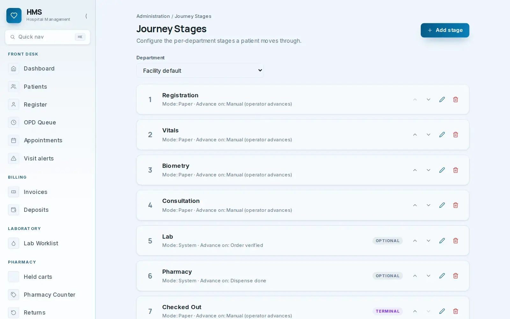
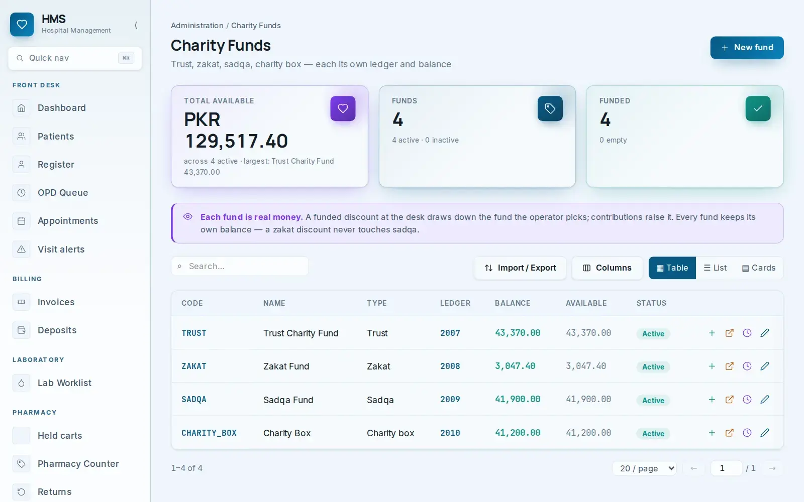
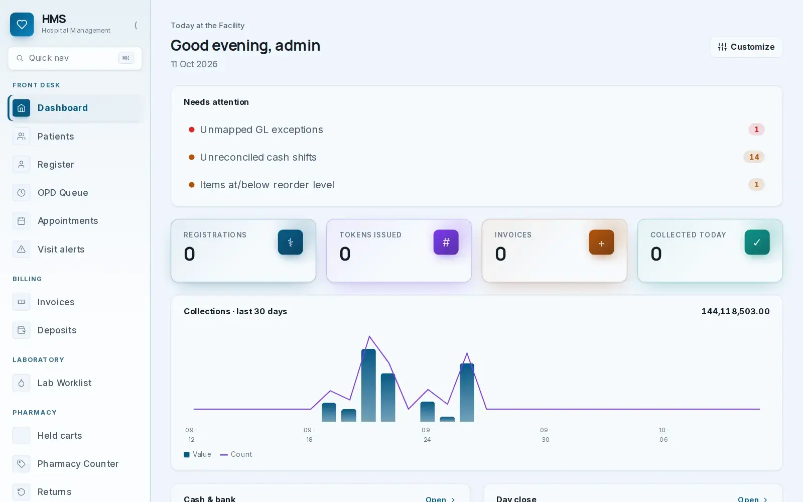
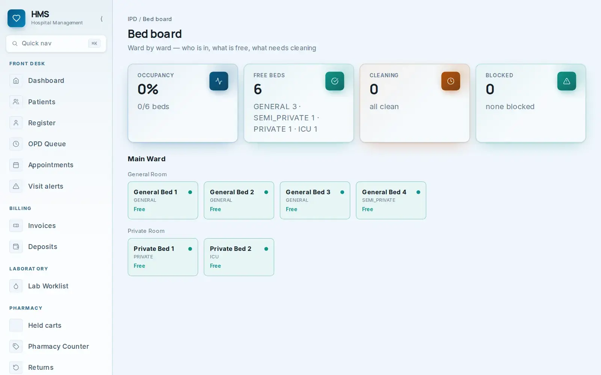
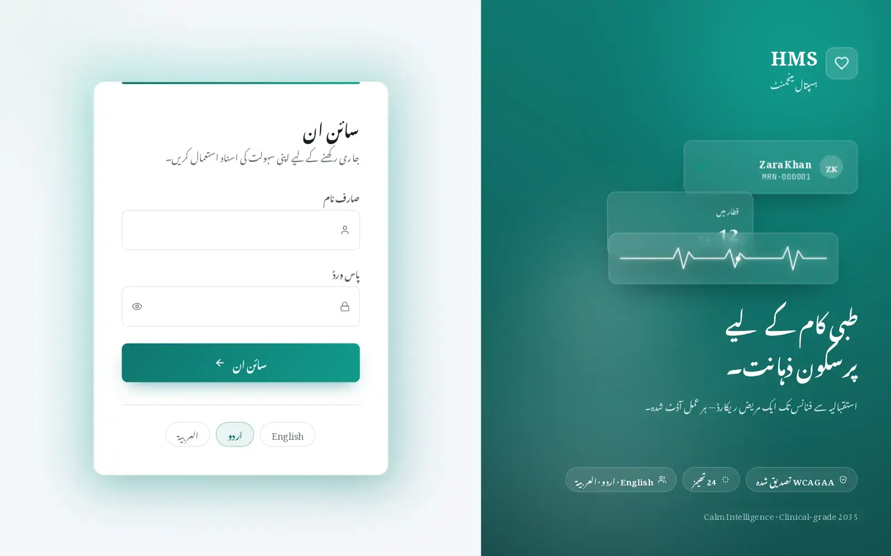

# EHMS — sources, captures and image analysis

## Evidence and reliability

| Source | Used for | Reliability boundary |
| --- | --- | --- |
| User-supplied pasted brief | Project origin, intended scope and links | The case-study section agrees with the public page; the later translated blog passage is garbled and contains impossible price text, so it is not used as a factual specification. |
| [Public EHMS case study](https://eaquirstech.com/en/work/ehms-hospital-management) | History, feature categories, published screenshots and outcomes | Vendor-published statements, not independently measured in this review. |
| [Public feature article](https://eaquirstech.com/en/blog/hospital-management-software-pakistan) | Detailed workflow descriptions and module list | Vendor narrative; useful product intent, not exhaustive acceptance evidence. |
| [Public charity-fund article](https://eaquirstech.com/en/blog/zakat-charity-fund-software-trust-hospital) | Separate fund/ledger behavior | Vendor description; fund policy still needs trust approval. |
| [Live authenticated EHMS](https://ehms.eaquirstech.com/patients) | 99 navigation destinations, page purpose, controls, form labels and list columns | Screen structure was inspected read-only. Record actions and posting effects were not performed. |

The public blog's sensible price statement differs radically from the pasted translated excerpt, which contains an absurdly long number. No pricing assertion appears in the product requirements. The live and published screens may show different facility states; a published image is a visual reference, not proof that the current tenant has the same records or settings.

## Live captures

| File | What it shows | Privacy note |
| --- | --- | --- |
| [01-login.jpg](../media/screenshots/01-login.jpg) | Live EHMS sign-in, language choices and product positioning | Captured before authentication; no credentials. |
| [02-public-case-study.jpg](../media/screenshots/02-public-case-study.jpg) | Full public case study page | Public marketing page. |
| [03-public-feature-article.jpg](../media/screenshots/03-public-feature-article.jpg) | Full public article page | Public marketing page. |
| [04-live-blank-registration.jpg](../media/screenshots/04-live-blank-registration.jpg) | Empty patient registration form, navigation and sticky action | No patient details entered. |
| [05-live-opd-queue.jpg](../media/screenshots/05-live-opd-queue.jpg) | Live OPD queue in its empty state | No patient rows visible. |
| [06-live-journey-configuration.jpg](../media/screenshots/06-live-journey-configuration.jpg) | Live journey-stage configuration with no stages in the current facility | No patient details. |

The authenticated patient index visibly contained real-looking names, identity numbers and phone numbers. It was inspected for **column labels only** and was not saved as a screenshot. The [research inventory](research/live-ui-inventory.json) likewise contains only navigation paths, page headings, buttons, form labels and table headers.

## Published product images, one by one

### 1. Journey stages — [journey-stages.webp](../media/reference/journey-stages.webp)

**Visible structure:** a department selector, Add stage action and ordered stage cards. The pictured facility-default sequence is Registration, Vitals, Biometry, Consultation, optional Lab, optional Pharmacy and terminal Checked Out. Each row shows a mode and an advance rule, plus reorder, edit and delete actions. Manual stages say the operator advances them; Lab advances on order verification; Pharmacy advances on dispense completion.

**Functional interpretation:** journey definitions are configurable per department. The next stage should be derived from completed/optional states and displayed to the department that owns the handoff. Reordering or deleting a stage that is already used by open visits requires an explicit effective-version rule. The live facility visited in this review currently showed “No stages defined yet,” so this published screenshot is not a current configuration snapshot.

### 2. Charity funds — [charity-funds.webp](../media/reference/charity-funds.webp)

**Visible structure:** total available, fund count, funded count, explanatory banner, search, import/export, columns, table/list/cards and rows for Trust, Zakat, Sadqa and Charity Box. Columns include code, name, type, ledger, balance, available and status; row actions appear for contribution/detail/history/edit. The banner says funded discounts draw down the operator-selected fund while contributions raise it.

**Functional interpretation:** each fund is a distinct GL account and restricted balance. A donation and a funded patient discount must link to the same fund ledger. The exact amounts and ledger numbers pictured are demo data and are not requirements.

### 3. Facility dashboard — [dashboard.webp](../media/reference/dashboard.webp)

**Visible structure:** personalized greeting and date; Customize action; Needs attention entries for unmapped GL exceptions, unreconciled cash shifts and low-stock items; cards for registrations, tokens, invoices and collected today; 30-day collection chart with value and count; lower cash/bank and day-close sections.

**Functional interpretation:** the dashboard combines operational throughput, financial collection and exception management. Attention items should link to their work queues. The chart should identify its date basis and distinguish currency value from transaction count. Public screenshot totals are illustrative only.

### 4. IPD bed board — [bed-board.webp](../media/reference/bed-board.webp)

**Visible structure:** occupancy, free, cleaning and blocked summary cards; ward and room groupings; bed cards with name, class and state. The image includes general, semi-private, private and ICU examples.

**Functional interpretation:** bed state changes must be tied to admission, discharge/transfer and housekeeping. Availability counts cannot include occupied, cleaning or blocked beds. The live tenant currently showed zero configured beds, so the pictured six-bed set is a published example, not a present inventory.

### 5. Urdu sign-in — [login-urdu.webp](../media/reference/login-urdu.webp)

**Visible structure:** right-to-left Urdu labels and messaging; username and password fields; password reveal; language choices for Arabic, Urdu and English; illustrative patient card and heartbeat; claims for WCAG AA and 24 themes.

**Functional interpretation:** language selection affects alignment, typography and controls, not just translated strings. The live English sign-in confirms the same three language choices; WCAG and theme claims require separate validation before being repeated as certified outcomes.

## Suggested later capture set

With a dedicated synthetic demo tenant, capture: patient index with fake identities, patient detail and encounter timeline, appointment booking, populated OPD queue, lab result/verification, prescription/dispense, surgery readiness, admission transfer, stock receipt and variance, claim denial, charity allocation drill-down, fund ledger, day-close checklist and role configuration. Each capture should show only synthetic identities and be accompanied by a short caption explaining the demonstrated state and action.

## Media usage

`media/reference` contains downloaded images published by Eaquirs Tech for this project. Preserve attribution and do not imply those screenshots were captured from the current authenticated tenant. `media/screenshots` contains this review's captures. Screenshots are evidence of a screen state on 12 October 2026, not a guarantee of behavior after later changes. Any external publication of these materials should be reviewed by the product owner for rights, current accuracy and privacy.
