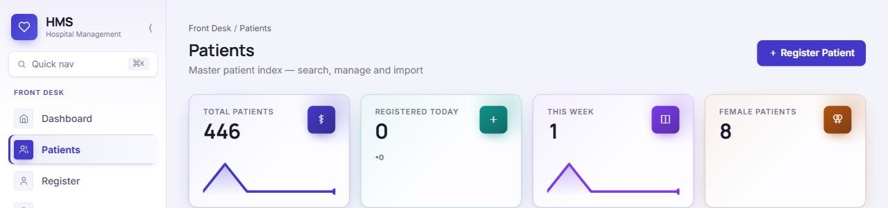
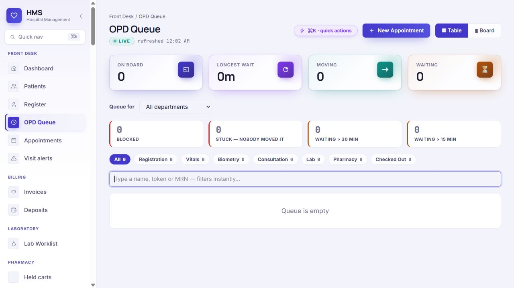
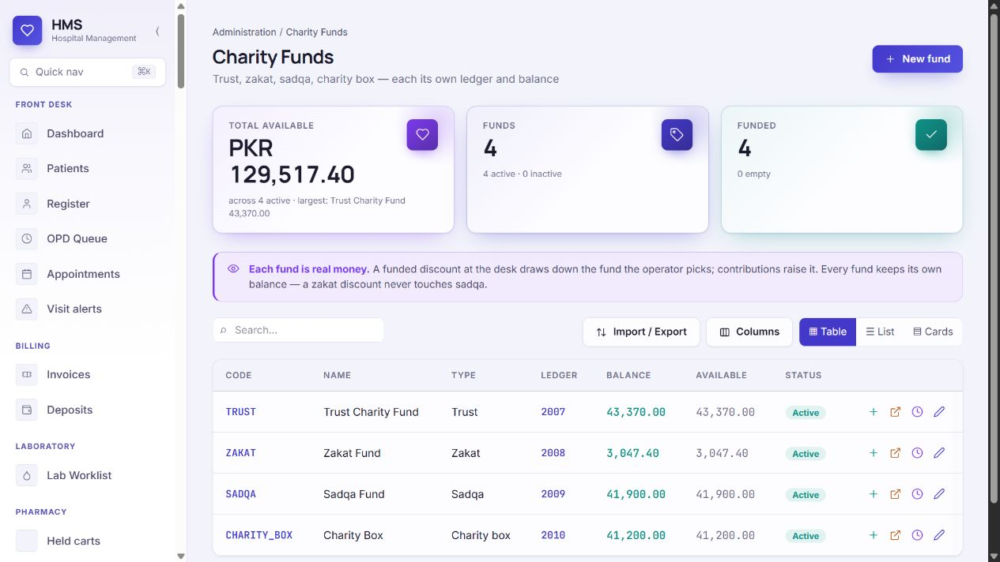

# EHMS · Royal Indigo screenshot set

Captured from the authenticated EHMS interface on **13 October 2026** after selecting **Royal Indigo** in Appearance. The theme was verified as selected after navigating away and returning. Images were reviewed before saving; patient index rows, claim rows, loading placeholders and broken metric states were excluded.

| # | Screen | Capture |
| --- | --- | --- |
| 01 | Appearance and selected theme | [01-appearance.jpg](01-appearance.jpg) |
| 02 | Patients overview, header only | [02-patients-header.jpg](02-patients-header.jpg) |
| 03 | Blank patient registration | [03-register-blank.jpg](03-register-blank.jpg) |
| 04 | Live OPD queue, empty state | [04-opd-queue.jpg](04-opd-queue.jpg) |
| 05 | IPD bed board | [05-bed-board.jpg](05-bed-board.jpg) |
| 06 | Surgery schedule | [06-surgery-schedule.jpg](06-surgery-schedule.jpg) |
| 07 | OT stock forecast | [07-stock-forecast.jpg](07-stock-forecast.jpg) |
| 08 | Roles and permissions | [08-roles-permissions.jpg](08-roles-permissions.jpg) |
| 09 | Charity funds | [09-charity-funds.jpg](09-charity-funds.jpg) |
| 10 | Day-close cockpit | [10-day-close.jpg](10-day-close.jpg) |
| 11 | Goods receipt dashboard | [11-goods-receipt.jpg](11-goods-receipt.jpg) |
| 12 | Blank prescription entry | [12-prescription-entry.jpg](12-prescription-entry.jpg) |

The patient overview is deliberately cropped above the record table. Registration and prescription forms are blank. Other screens show facility-level operational or financial figures as they appeared at capture time; treat those figures as time-bound interface evidence.

